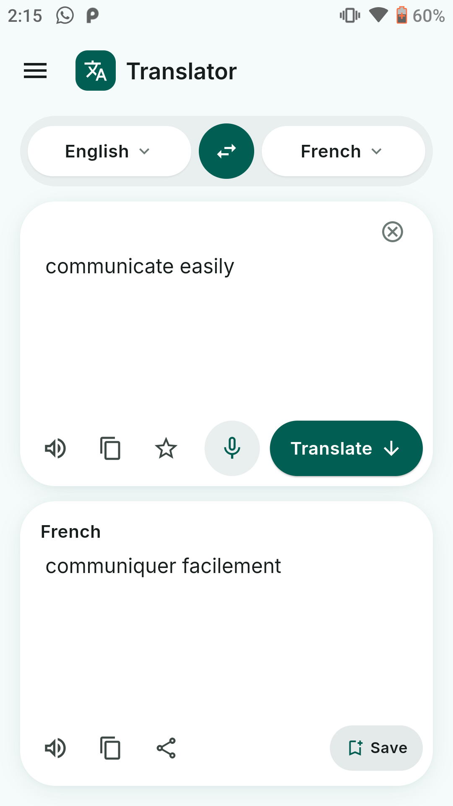
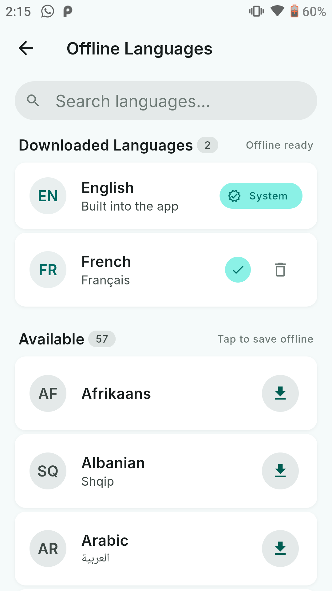
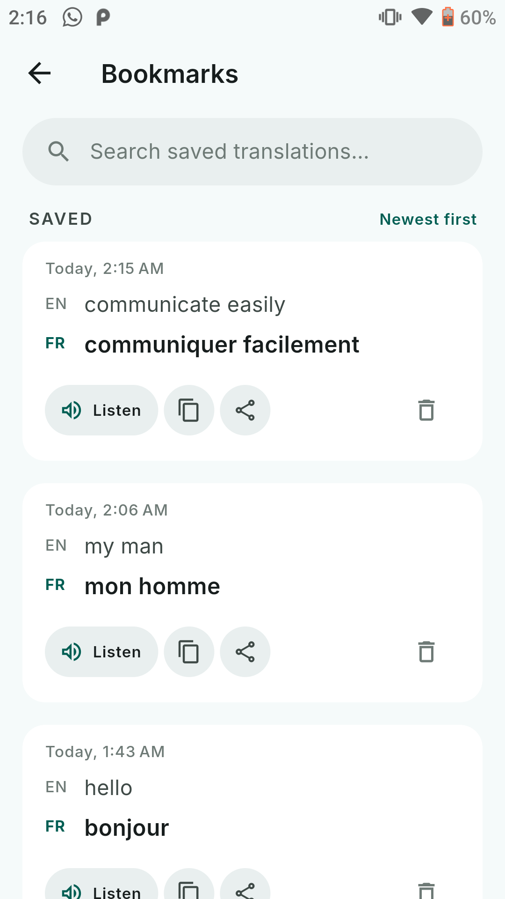
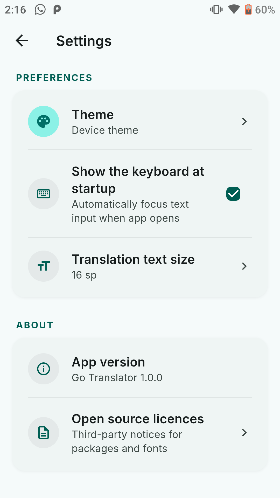

# Go Translator

An Android translator that translates on your phone. Download a language once and translate without an internet connection.

## Features

### Translate

- Translation runs on the device with Google ML Kit models. Once a language is downloaded, translating needs no internet.
- 59 languages. Pick the source and target language from the language bar, and swap them with one tap.
- If a language isn't downloaded yet, the app offers to download it before translating.
- Voice input: tap the mic and speak. On Android this uses Google's speech dialog, which needs an internet connection; the in-app voice dialog is used when it isn't available.
- Listen to the source text and the translation (text-to-speech), copy either one, and share the translation.

### Offline languages

- See which languages are downloaded and which are available.
- Download or delete languages. English is built in.
- Search by English or native name, for example "Français" or "العربية".

### Bookmarks

- Save a phrase with the star in the source card, or its translation with Save in the translation card.
- Saved phrases show when they were saved and their languages, newest first.
- Search, listen, copy and share saved phrases. Deleting one can be undone.

### Settings

- Theme: follow the device, light or dark.
- Show the keyboard at startup, on or off.
- Translation text size from 14 to 32 sp, with a live preview.
- App version and open source licences.

## Screenshots

| Translator | Offline languages |
|---|---|
|  |  |

| Bookmarks | Settings |
|---|---|
|  |  |
